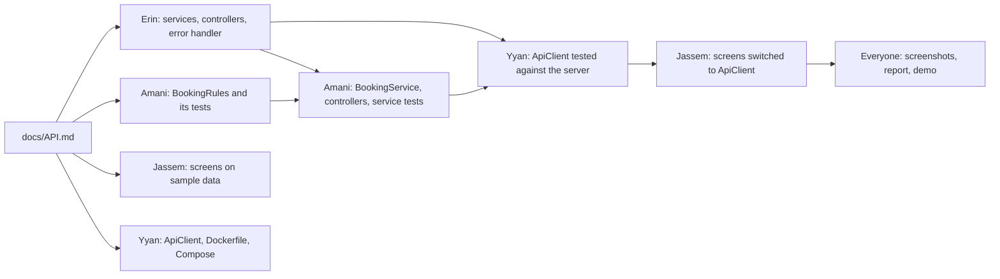

# CoWorkHub task index

The application skeleton files have owner headers and `TODO(Name)` comments. Retained TODOs describe implementation responsibilities, including some work already completed; a TODO marker alone does not mean the method is unfinished.

Find your TODOs:

```bash
grep -rn "TODO(Erin)"   backend frontend docs README.md docker-compose.yml .env.example
grep -rn "TODO(Amani)"  backend
grep -rn "TODO(Jassem)" frontend
grep -rn "TODO(Yyan)"   .
```

The shared contract is [API.md](API.md). Field names, paths, status codes, and error messages come from there.

## Keep the implementation basic

- The brief requires the behavior and the controller → service → repository separation, not extra abstraction layers. Use simple checks and loops in the existing classes.
- Keep one `BookableResourceRepository` for rooms and desks. The existing `findAll()` plus `ResourceFilter.matches` loop handles resource filters; no additional resource queries are needed.
- Booking overlap uses `BookingRules.overlaps` on confirmed bookings loaded by resource. On edit, skip the booking's own ID. Use the same rule for availability.
- Use request field annotations and simple service checks. Keep error JSON in `GlobalExceptionHandler` and booking response conversion in `BookingResponse.from` called by the service.
- Part 5's screen list is a suggested layout. Simple navigation, lists, forms, loading text, and success/error messages are enough. Summary cards, separate details panels, confirmation dialogs, retry buttons, and split lists are optional, not checklist requirements.
- Member editing is an existing API addition. Creating/listing members and showing their bookings are the brief's minimum member features.
- JOINED, H2 for local work, Swagger, and the exact URLs/pricing convention are project choices. Keep them simple; PostgreSQL in Docker with persistent storage remains part of the agreed deployment.

## Current backend foundation

This describes the implementation at this update. Everyone must still be able to explain these pieces in the Q&A.

- `backend/pom.xml`, the Maven wrapper, and `application.properties`. The server starts with `./mvnw spring-boot:run`.
- Database mapping on `Member`, `BookableResource`, `MeetingRoom`, `Desk`, and `Booking`: JOINED inheritance, generated ids, Lombok `@NoArgsConstructor`, `@ManyToOne` and `@JoinColumn` on the booking, `@OneToMany(mappedBy)` on member and resource, and `@JsonIgnore` on the two bookings lists. Lombok `@Getter` and `@Setter` generate the accessors. Use those, never `@Data`, because `@Data` loops through the two-way booking relationship.
- Member and resource services, controllers, filters, and validation are implemented. Booking and availability endpoints remain TODOs. Swagger lists routes even when their bodies are unfinished.
- The exception classes, `ApiError`, and `GlobalExceptionHandler` are implemented. Member duplicate checks use the specific email-conflict message; other database failures use a general conflict message.
- All 57 resource/member curl checks passed against throwaway H2, with temporary SQL fixtures for confirmed and cancelled booking history. Maven passes 12 tests; 22 booking tests remain disabled and are not evidence that booking behavior works. Docker/PostgreSQL persistence still needs verification.
- Flutter: the `http` package, the macOS network permission, the model fields, sample data, and an app that opens a placeholder window.

## Order of work and dependencies



### Erin, backend foundation

Steps 1–5 below are implemented. Retained TODO comments are useful for review and Q&A. Finish the report note and verify PostgreSQL persistence once Docker works.

1. `exception/GlobalExceptionHandler.java`: all handler bodies. Every 400, 404, and 409 in the project depends on this.
2. `member/MemberService.findById` and `resource/ResourceService.findById`. Amani's booking code calls both.
3. `member/`: `MemberRepository` derived query, `MemberRequest` validation, `MemberService`, `MemberController` with `@Valid`.
4. `resource/`: `ResourceFilter.matches`, request validation, `ResourceService`, `ResourceController` with `@Valid`.
5. Bean Validation annotations on `Member`, `BookableResource`, and `Desk`.
6. Check each item with curl or Swagger, as listed in the checklist below.
7. Report note: why JOINED, and the member and resource endpoints with their status codes.

### Amani, booking rules and endpoints

1. Implement `booking/BookingRules.java` and `src/test/.../BookingRulesTest.java`. The rules can be tested without Spring or a database.
2. Start today: `booking/BookingRepository.java` derived queries, `BookingResponse.from`, and validation on `BookingCreateRequest`.
3. Use Erin's lookup methods and resource filtering in `booking/BookingService.java`, then wire `BookingController.java` and `AvailabilityController.java`.
4. Confirm the 400, 404, and 409 responses with curl using the shared error handler.
5. After step 3: `src/test/.../BookingServiceTest.java`.
6. Report note: the pricing rule, the status codes, and the test results for the rejected cases.

### Jassem, Flutter screens

1. Implement `fromJson` in `lib/models/`, then the required list/form workflows. Use the existing screens and small widgets where useful; sample data can be used while the HTTP client is unfinished.
2. Start today: the navigation in `lib/main.dart`.
3. After Yyan's ApiClient works: replace the sample data with ApiClient calls on every screen, add loading, success, and error states, and refresh after each save.
4. Delete `lib/models/sample_data.dart`.
5. Take the screen captures for the report.

### Yyan, connection, Docker, and submission

1. Start today: `frontend/lib/services/api_client.dart`, every method written against API.md.
2. Start today: `backend/Dockerfile`, `docker-compose.yml`, and `.env.example`. The server already starts, so Docker can be tested now.
3. After Erin's and Amani's controllers work: test each ApiClient method against the running server.
4. `README.md`: team names and the exact run steps, tested on a machine without PostgreSQL.
5. Collect everyone's report sections into `TeamName_Project_Report.pdf`, using [REPORT_OUTLINE.md](REPORT_OUTLINE.md).
6. Build `TeamName_Project.zip` without generated folders.

### Everyone

Use [DEMO_AND_QA.md](DEMO_AND_QA.md). Each person writes the report section for their own part and practices tracing one booking through every layer.

## Delegation sheet checklist mapped to files

### Erin

| Checklist item | Where |
|---|---|
| POST /api/members returns 201 and a database-generated id | `MemberController.create`, `MemberService.create` |
| POST of that same email returns 409 | `MemberService.create`, `MemberRepository`, `GlobalExceptionHandler.handleConflict` |
| GET /api/members lists members | `MemberController.list` |
| Existing addition: PUT /api/members/{id} updates a member | `MemberController.update`, `MemberService.update` |
| POST /api/resources/rooms and /desks return 201 with "type" and the fields | `ResourceController`, `ResourceService.createRoom` and `createDesk`; `type` comes from the `getType()` method in each subclass |
| GET /api/resources filters by type, minimum capacity, location, maximum price | `ResourceController.list`, `ResourceFilter.matches` |
| PUT /api/resources/{id} updates, including OUT_OF_SERVICE | `ResourceService.update` |
| DELETE succeeds only with zero bookings | `ResourceService.delete` |
| DELETE returns 409 with any booking, including cancelled | `ResourceService.delete` |
| Missing id 404; missing fields 400 with a readable message | `findById` methods, `@Valid`, `GlobalExceptionHandler` |
| No endlessly nested list of bookings | Done: `@JsonIgnore` on `Member.bookings` and `BookableResource.bookings` |
| Rows survive a restart with ddl-auto=update | Configured in `application.properties`; verify with Yyan's persistent PostgreSQL volume |
| Report note on JOINED and endpoints | Explanation at the top of `BookableResource.java` |

### Amani

| Checklist item | Where |
|---|---|
| POST /api/bookings returns 201, CONFIRMED, totalCost set by the server | `BookingController.create`, `BookingService.create` |
| 90 minutes at 40 per hour costs 60.00 | `BookingRules.calculateTotalCost`, `BookingRulesTest` |
| End before start returns 400 | `BookingRules.validateTimes` |
| Missing member or resource returns 404 | `BookingService.create` calls Erin's `findById` |
| A desk accepts one attendee only | `BookingRules.validateAttendees` |
| A room rejects attendees above capacity | `BookingRules.validateAttendees` |
| Overlapping CONFIRMED bookings return 409 | `BookingRules.overlaps`, `BookingRepository`, `BookingService.create` |
| Back-to-back booking allowed | `BookingRules.overlaps` used by the service |
| Edit rechecks, skips its own ID, recalculates totalCost | `BookingService.update`, `BookingRules.overlaps` |
| OUT_OF_SERVICE resource cannot be booked | `BookingService.create` and `update` |
| Cancel keeps the row and frees the time | `BookingService.update`; only CONFIRMED is checked for overlap |
| GET /api/bookings shows cancelled bookings | `BookingService.findAll` |
| GET /api/bookings?memberId= returns that member's bookings | `BookingService.findByMember` |
| GET /api/resources/available returns ACTIVE, conflict-free resources | `AvailabilityController`, `BookingService.findAvailableResources` |
| No delete-booking endpoint | `BookingController` has no `@DeleteMapping` |
| Automated tests cover each rejection | `BookingRulesTest`, `BookingServiceTest` |
| Report note: pricing, status codes, test results | `BookingRules.calculateTotalCost` comment and the test output |

### Jassem

| Checklist item | Where |
|---|---|
| Simple navigation to the required workflows; summary counts optional | `main.dart`, `home_screen.dart` |
| Resource list shows type and every required field; one list is enough | `resources_screen.dart` |
| Resource list filters; show details in the list or form | `resource_filter_bar.dart`, `resources_screen.dart` |
| Create/update rooms and desks, set OUT_OF_SERVICE, and create members; member editing optional | `resource_form_screen.dart`, `member_form_screen.dart` |
| Deleting a resource with bookings shows the server's 409 message | `ResourcesScreen.deleteResource` |
| New booking collects all fields and shows availability results | `new_booking_screen.dart` |
| Form blocks empty name, empty email, end before start, empty attendees | the validators in each form screen |
| Bookings screen shows current, past, and cancelled bookings with status and cost | `bookings_screen.dart`, `Booking.isPast` |
| Bookings can be edited and cancelled | `BookingsScreen.editBooking` and `cancelBooking`, `booking_edit_screen.dart` |
| Choosing a member shows that member's bookings | `MembersScreen.selectMember` |
| Loading, then success or the server's error message | `loading_view.dart`, `error_view.dart`, `feedback.dart` |
| List refreshes after create, update, or cancel | each screen reloads when its form returns `true` |
| Ordinary Flutter desktop widgets, no unnecessary OS-specific code | all of `lib/`; keep standard desktop runner files |

### Yyan

| Checklist item | Where |
|---|---|
| ApiClient is the only HTTP caller, async/await, GET/POST/PUT/DELETE for every endpoint | `lib/services/api_client.dart` |
| Dart models match the JSON | `lib/models/` compared with API.md |
| Multi-stage Dockerfile that builds from source without target/ | `backend/Dockerfile`, `backend/.dockerignore` |
| Compose: backend and PostgreSQL, environment variables, named volume | `docker-compose.yml` |
| ddl-auto=update in Docker | Done in `application.properties`; Compose must not override it |
| .env.example has placeholders only | `.env.example` |
| README names everyone and gives exact run steps | `README.md` |
| Clean machine: copy .env, compose up, curl /api/resources returns a list | test after Erin's resource controller works |
| compose down then up keeps the data | named volume in `docker-compose.yml` |
| .gitignore excludes target, build, .dart_tool, .env | Done: `.gitignore` |
| ZIP contents without generated folders | submission step |
| PDF report sections | `docs/REPORT_OUTLINE.md` |

### Everyone

| Checklist item | Where |
|---|---|
| Live demo: Docker start, one successful booking with price, one rejected overlap shown in the window | `docs/DEMO_AND_QA.md` |
| Every member speaks | `docs/DEMO_AND_QA.md` |
| Every member can trace a booking from Flutter to the database | `docs/DEMO_AND_QA.md`, trace section |
| Every member can make a small change in code they did not write | `docs/DEMO_AND_QA.md`, practice changes |
| Every member named in README and contribution table | `README.md`, `docs/REPORT_OUTLINE.md` |

## Brief requirements mapped to files

| Brief section | Requirement | Where | Owner |
|---|---|---|---|
| 1 | Separate UI, HTTP, business logic, data access, and database layers | `screens/` → `api_client.dart` → `*Controller` → `*Service` → `*Repository` → database | all |
| 2 | JPA inheritance with a justified strategy | `BookableResource.java` | Erin |
| 2 | Booking belongs to one member and one resource with `@ManyToOne` and `@JoinColumn` | `Booking.java` | Amani |
| 2 | One-to-many with `mappedBy` | `Member.java`, `BookableResource.java` | Erin |
| 2 | Generated ids, no-argument constructors | every entity | Erin, Amani |
| 2 | JpaRepository, derived queries only when needed | `*Repository.java` | Erin, Amani |
| 2 | Jackson annotations against circular JSON | `@JsonIgnore` on the bookings lists; flat `BookingResponse` | Erin, Amani |
| 3.1 | Display all resources, rooms distinguished from desks | `ResourceController.list`, `resources_screen.dart` | Erin, Jassem |
| 3.1 | Create, update, delete resources; reject delete with any booking | `ResourceService`, `resource_form_screen.dart` | Erin, Jassem |
| 3.1 | Show name, type, location, capacity, rate, status | `Resource` model, `resources_screen.dart` | Jassem |
| 3.1 | Availability calculated, not stored as a status | `BookingService.findAvailableResources` | Amani |
| 3.1 | Filter by type, capacity, location, or price | `ResourceFilter`, `resource_filter_bar.dart` | Erin, Jassem |
| 3.2 | Create and display members; name and unique email | `MemberService`, `members_screen.dart` | Erin, Jassem |
| 3.2 | Display a selected member's bookings | `BookingService.findByMember`, `MembersScreen.selectMember` | Amani, Jassem |
| 3.3 | Create a booking from ids; server sets status and cost | `BookingService.create` | Amani |
| 3.3 | Update a booking when the new slot is valid | `BookingService.update` | Amani |
| 3.3 | Cancel through an update endpoint, keeping history | `BookingService.update`, `BookingsScreen.cancelBooking` | Amani, Jassem |
| 3.3 | Display current and past bookings | `bookings_screen.dart` | Jassem |
| 3.3 | Total from rate and duration | `BookingRules.calculateTotalCost` | Amani |
| 3.4 | No overlapping CONFIRMED bookings; adjacent allowed; exclude self on update | `BookingRules.overlaps`, `BookingRepository` | Amani |
| 3.4 | Start before end | `BookingRules.validateTimes` | Amani |
| 3.4 | Desk one attendee; room within capacity | `BookingRules.validateAttendees` | Amani |
| 3.4 | OUT_OF_SERVICE cannot be booked | `BookingService` | Amani |
| 3.4 | Cancelling frees the slot; cancelled stays in history | `BookingService` | Amani |
| 3.4 | Correct status codes and useful messages | `GlobalExceptionHandler`, API.md messages | Erin |
| Checkpoint | Invalid booking rejected at the backend and shown in Flutter | `BookingService`, `NewBookingScreen.submit`, `feedback.dart` | Amani, Jassem |
| 4 | Subtype choice documented | separate `/rooms` and `/desks` endpoints; `ResourceController` header and report | Erin |
| 4 | Every endpoint in the table | `MemberController`, `ResourceController`, `BookingController`, `AvailabilityController` | Erin, Amani |
| 5 | Usable navigation and resource/member/booking workflows; the suggested screens may be combined | `lib/screens/` | Jassem |
| 5 | Dart models map JSON | `lib/models/` | Jassem, Yyan |
| 5 | HTTP calls in a dedicated client class | `lib/services/api_client.dart` | Yyan |
| 5 | Future, async, and await | `api_client.dart`, the screen load and save methods | Yyan, Jassem |
| 5 | Loading, success, and error states | `lib/widgets/` | Jassem |
| 5 | Validate forms before sending | form screen validators | Jassem |
| 5 | Refresh the UI after create, update, cancel | screen reload methods | Jassem |
| 5 | Folders `models/`, `services/`, `screens/`, `widgets/` | `frontend/lib/` | Jassem |
| 6 | Multi-stage backend Dockerfile from source, not depending on target/ | `backend/Dockerfile` | Yyan |
| 6 | PostgreSQL in Compose, connected through environment variables | `docker-compose.yml`, `application.properties` | Yyan, Erin |
| 6 | Persistent volume; no create or create-drop | `docker-compose.yml`, `application.properties` | Yyan, Erin |
| 6 | No real secrets; `.env.example` | `.env.example`, `.gitignore` | Yyan |
| 6 | `docker compose up --build` documented | `README.md` | Yyan |
| Cross-platform | No unnecessary platform-specific code | `frontend/lib/` | Jassem |
| Deliverable 1 | ZIP with `backend/`, `frontend/`, Compose, Dockerfiles, README, `.env.example`; no generated folders | submission | Yyan |
| Deliverable 2 | Report with every required section | `docs/REPORT_OUTLINE.md` | Yyan, everyone |
| Deliverable 3 | Presentation, live demo, Docker shown, everyone participates, individual Q&A | `docs/DEMO_AND_QA.md` | everyone |
